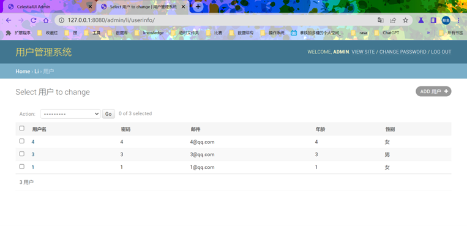
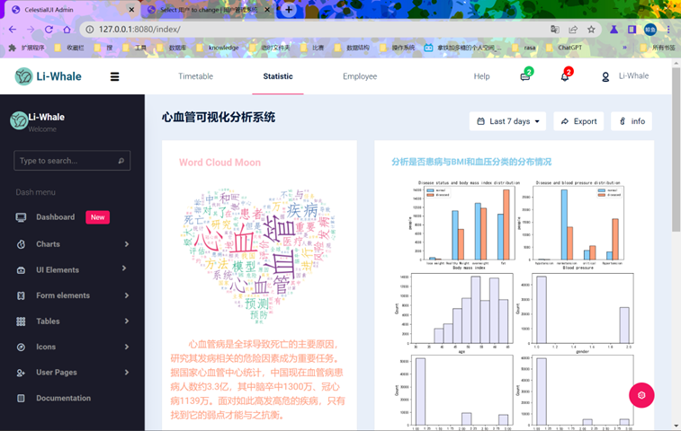
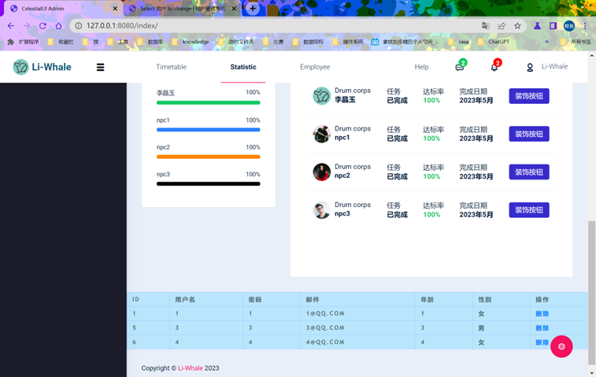
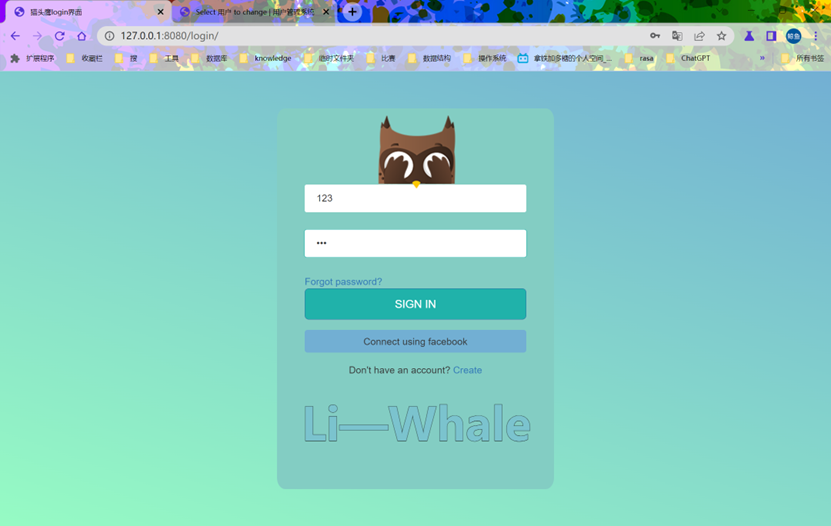
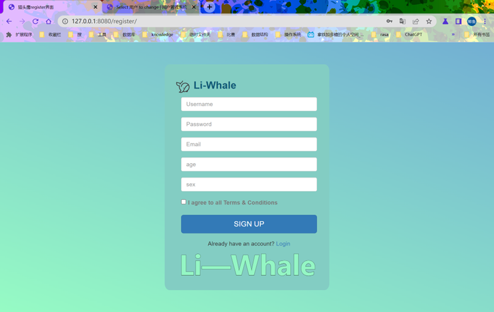

基于 Django + MySQL 的 心血管数据可视化和用户管理网站。项目包含用户登录、用户信息管理、后台管理和数据图表页面，用于学习 Django 的基本开发流程。

## 主要功能

- 用户登录和注册页面
- 用户信息展示与删除
- Django Admin 用户管理
- 基于 MySQL 和 JSON 数据生成图表
- 使用 ECharts、Chart.js 和 jQuery 展示页面
- 自定义 404 页面

## 技术栈

- Python 3.7
- Django 2.2.x
- MySQL
- PyMySQL
- HTML、CSS、JavaScript
- ECharts、Chart.js、jQuery

> `settings.py` 由 Django 3.2.18 生成，但 `li/views.py` 使用了 Django 3.x 已移除的 `render_to_response`。为减少代码修改，本文使用 Django 2.2.28 运行当前项目。

## 项目结构

```text
Liwhale/
├── Liwhale/                 # 项目配置
│   ├── settings.py          # Django 和数据库配置
│   ├── urls.py              # 项目路由
│   ├── asgi.py
│   └── wsgi.py
├── li/                      # 主应用
│   ├── migrations/          # 数据库迁移文件
│   ├── static/              # CSS、JavaScript、字体和图片
│   ├── templates/           # HTML 模板
│   ├── admin.py             # 后台管理配置
│   ├── models.py            # 用户数据模型
│   └── views.py             # 页面和业务逻辑
├── les-miserables.json      # 图表数据
├── stock-DJI.json           # 图表数据
├── manage.py                # Django 管理入口
└── README.md
```
## 数据库

`Liwhale/settings.py` 配置默认数据库：

```python
DATABASES = {
    'default': {
        'ENGINE': 'django.db.backends.mysql',
        'NAME': 'django',
        'USER': 'root', # 需要修改成自己的username
        'PASSWORD': 'PASSWORD', # 需要修改成自己的password
        'HOST': '127.0.0.1',
        'PORT': '3306',
    }
}
```

## 开发步骤

### 1. 创建项目

```bash
django-admin startproject Liwhale
```

命令执行后生成 `Liwhale/` 项目目录，其中包含 `settings.py`、`urls.py` 和 `manage.py` 等文件。

### 2. 创建应用

```bash
python manage.py startapp li
```

命令生成 `li/` 应用目录。创建后需要在 `Liwhale/settings.py` 的 `INSTALLED_APPS` 中注册该应用：

```python
INSTALLED_APPS = [
    # ...
    'li.apps.LiConfig'
]
```

### 3. 在 models.py 中创建数据模型

`li/models.py` 定义用户模型 `UserInfo`，字段包括用户名、密码、邮件、年龄和性别。模型对应的数据表名为 `li_userinfo`。

模型修改后需要生成并执行迁移：

```bash
python manage.py makemigrations
python manage.py migrate
```

### 4. 在 admin.py 中修改后台管理系统名称

`li/admin.py` 通过下面三个属性设置后台页面的标题：

```python
admin.site.site_header = "用户管理系统"
admin.site.site_title = "用户管理系统"
admin.site.index_title = "用户管理系统"
```

### 5. 在 admin.py 中设置模型显示的字段

自定义 `ModelAdmin` 类，用 `list_display` 指定后台列表中显示的字段：

```python
@admin.register(UserInfo)
class IAdmin(admin.ModelAdmin):
    list_display = ['user', 'pwd', 'email', 'age', 'sex']
```

### 6. 在 apps.py 中设置应用名称

`li/apps.py` 的 `LiConfig` 类用于配置应用。Django 读取的是 `verbose_name` 属性，用它设置应用在后台管理系统中的显示名称：

```python
class LiConfig(AppConfig):
    default_auto_field = 'django.db.models.BigAutoField'
    name = 'li'
    verbose_name = "管理系统"
```

### 7. 运行效果截图

运行效果截图存放在 `img/` 目录，见下文“运行截图”。

## 环境准备

请提前安装以下软件：

- Python 3.7
- MySQL

建议使用虚拟环境安装依赖。在 Windows 的 Git Bash 中执行：

```bash
python -m venv .venv
source .venv/Scripts/activate
python -m pip install Django==2.2.28 PyMySQL mysqlclient
```

其中，`mysqlclient` 是 Django 的 MySQL 后端驱动，`PyMySQL` 用于视图中的直接数据库查询。

## 数据库配置

### 1. 创建数据库

在 MySQL 中创建默认业务数据库：

```sql
CREATE DATABASE django CHARACTER SET utf8mb4 COLLATE utf8mb4_unicode_ci;
```

部分图表页面还使用 `cardio` 数据库：

```sql
CREATE DATABASE cardio CHARACTER SET utf8mb4 COLLATE utf8mb4_unicode_ci;
```

### 2. 修改连接信息

根据自己的 MySQL 环境修改 `Liwhale/settings.py` 中的数据库名称、用户名、密码、主机和端口。

`li/views.py` 中还有直接使用 PyMySQL 连接数据库的代码，也需要同步修改。

### 3. 准备图表数据

图表功能依赖 `cardio_train` 数据表：

- `chartjs/` 从 `cardio` 数据库读取该表。
- `dropdowns/` 从 `django` 数据库读取该表。

项目未提供该表的建表 SQL 和原始数据。使用这些页面前，需要自行准备并导入数据。缺少数据表时，相关页面会提示数据库错误。

## 启动项目

在项目根目录执行数据库迁移：

```bash
python manage.py migrate
```

如需使用 Django Admin，创建管理员账号：

```bash
python manage.py createsuperuser
```

启动开发服务器：

```bash
python manage.py runserver 8080
```

启动后可访问：

- 登录页面：<http://127.0.0.1:8080/login/>
- 用户列表：<http://127.0.0.1:8080/index/>
- 图表页面：<http://127.0.0.1:8080/chartjs/>
- 后台管理：<http://127.0.0.1:8080/admin/>


## 主要路由

| 路由 | 说明 |
| --- | --- |
| `/login/` | 用户登录 |
| `/register/` | 注册页面 |
| `/index/` | 用户信息列表 |
| `/index/delete/?nid=用户ID` | 删除指定用户 |
| `/chartjs/` | 数据图表页面 |
| `/dropdowns/` | 吸烟数据统计页面 |
| `/draft/` | 用户数据草稿页面 |
| `/documentation/` | 文档页面 |
| `/admin/` | Django 后台管理 |

## 运行截图

截图文件存放在 `img/` 目录。

### 后台管理



后台地址为 `/admin/li/userinfo/`，列表中显示用户名、密码、邮件、年龄和性别。

### 数据图表



对应 `/chartjs/` 页面，包含词云和心血管数据分析图表。

### 用户列表



对应 `/index/` 页面，展示用户数据、任务完成情况和删除操作。

### 登录页面



对应 `/login/` 页面。

### 注册页面



对应 `/register/` 页面。


